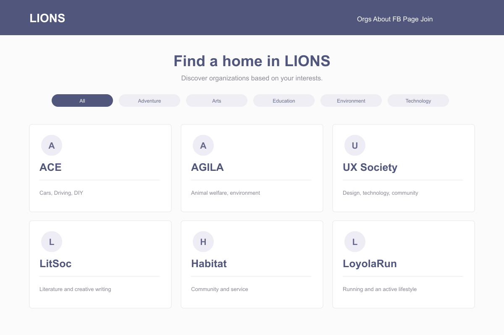

# Portfolio screens

Prepared for the Davin Cuaso portfolio on 6 November 2026.

These are source-based interface recreations with fictional sample data. They are not screenshots from a running native app or backend. Camera scenes and ingredient illustrations are schematic; measurements, saved places, and study statistics are sample content.

The SVG files are editable masters; PNG files are opaque exports.

The archive lacks the logo files referenced by its HTML. This recreation uses neutral initials in their place.

## Organization directory

Source: [index.html](https://github.com/davincuaso/lionshub/blob/7f63ae2b7f188b519f60fdcac5dd5cea4c9e4ca0/index.html), [style.css](https://github.com/davincuaso/lionshub/blob/7f63ae2b7f188b519f60fdcac5dd5cea4c9e4ca0/style.css).

